# 오늘 한 줄 (Daily Line)

하루에 한 줄, 그날의 기분과 함께 짧은 일기를 남기는 스티커 다이어리 앱입니다.
React Native(Expo)로 만든 앱과, 로컬에서 돌아가는 FastAPI + SQLite 서버로 구성되어 있습니다.

<p>
  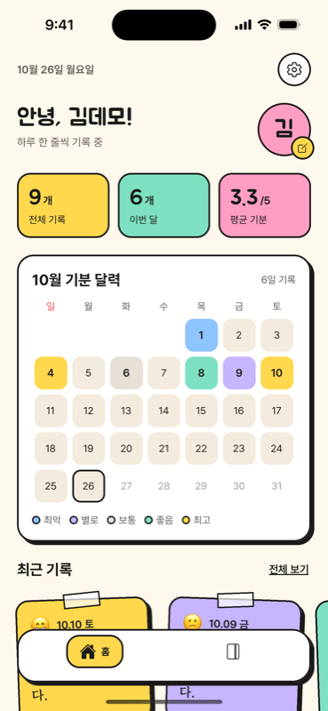
  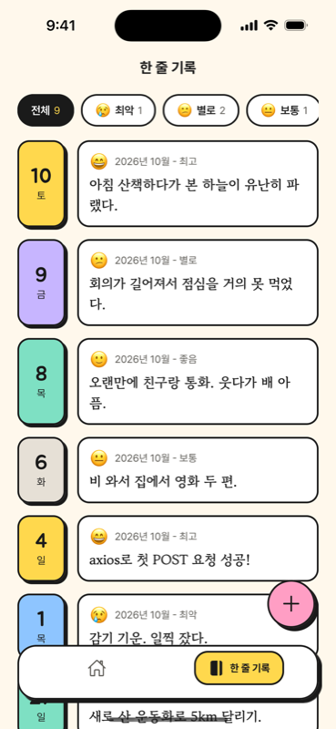
  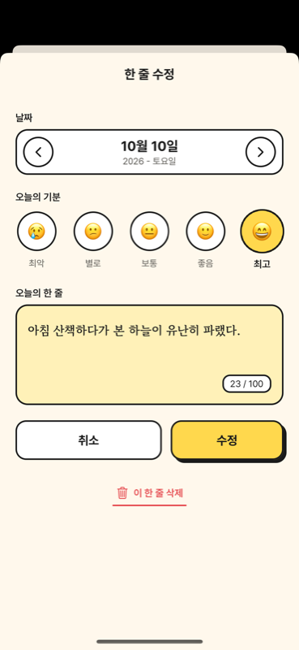
</p>

## 주요 기능

- **인증:** 이메일 회원가입, 로그인, 로그아웃, 자동 로그인 (토큰을 SecureStore에 저장)
- **홈:** 인사, 통계(전체 기록, 이번 달, 평균 기분), 이번 달 기분 달력, 최근 기록 메모 카드
- **한 줄 기록:** 기분별 필터, 날짜순 목록
- **한 줄 쓰기, 수정, 삭제:** 하루에 한 줄만 (같은 날짜는 서버가 409로 거절)
- **프로필 수정, 계정 관리, 회원 탈퇴:** 탈퇴하면 일기와 세션까지 함께 삭제
- **요청 상태 처리:** 로딩 오버레이, 에러 배너, 불러오기 실패 화면, 토큰 만료(401) 시 자동 로그아웃

## 기술 스택

| 구분 | 사용 기술 |
|---|---|
| 앱 | React Native 0.86, Expo SDK 57, React 19, JavaScript |
| 네비게이션 | React Navigation 7 (Native Stack, Bottom Tabs) |
| 상태 관리 | Context API (`AuthContext`, `EntriesContext`) |
| HTTP | axios (`api/client.js`의 인스턴스 하나로 baseURL, timeout 관리) |
| 저장소 | expo-secure-store (로그인 토큰) |
| 폰트 | Jua, Pretendard, Gowun Batang (expo-font) |
| 서버 | Python, FastAPI, SQLite (표준 라이브러리 `sqlite3`) |

## 화면

### 인증

| 로그인 | 회원가입 |
|:---:|:---:|
| 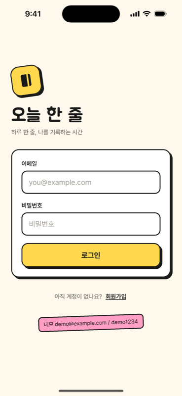 | 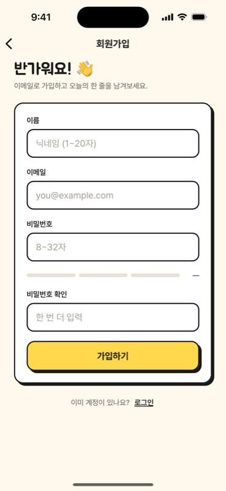 |

- **로그인:** 이메일 형식과 빈 값을 앱에서 먼저 검사하고, 통과하면 서버로 보냅니다. 서버가 거절하면 입력값은 그대로 두고 버튼 위에 에러 배너를 띄웁니다.
- **회원가입:** 이름, 이메일, 비밀번호, 비밀번호 확인을 검사합니다. 비밀번호 강도 막대를 입력할 때마다 보여 줍니다. 가입에 성공하면 바로 로그인 상태가 됩니다.
- 앱을 다시 켜면 저장된 토큰으로 `GET /users/me`를 호출해서 자동 로그인합니다. 확인이 끝날 때까지 스플래시 화면을 유지합니다.

### 홈과 한 줄 기록

| 홈 | 한 줄 기록 | 한 줄 기록 (빈 목록) |
|:---:|:---:|:---:|
|  |  | 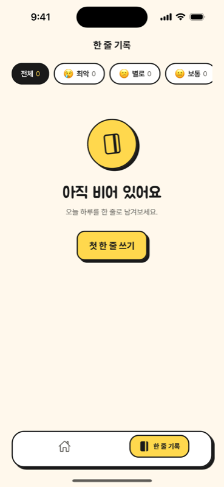 |

- **홈:** 헤더 없이 safe area 안쪽부터 직접 그립니다. 일기 목록을 불러와서 통계와 기분 달력을 계산하고, 최근 기록 5개를 기울어진 메모 카드로 보여 줍니다.
  - 카드를 누르면 수정 화면, 아바타의 연필 배지를 누르면 프로필 수정, ⚙ 버튼을 누르면 계정 화면으로 이동합니다.
  - 불러오기에 실패하면 다시 시도 버튼이 있는 에러 화면을 보여 줍니다.
- **한 줄 기록:** 홈이 불러온 목록을 `EntriesContext`로 같이 씁니다(추가 요청 없음). 기분 칩으로 거르고, 오른쪽 아래 + 버튼으로 새 한 줄을 씁니다.
- **빈 목록:** 기록이 없으면 스티커와 "첫 한 줄 쓰기" 버튼을 보여 주고, 버튼이 두 개가 되지 않도록 + 버튼은 숨깁니다.
- 탭바는 화면 위에 떠 있는 카드 모양이고, 선택된 탭은 노란 알약으로 표시합니다.

### 한 줄 쓰기와 수정

| 한 줄 쓰기 | 한 줄 수정 | 저장 실패 (409) |
|:---:|:---:|:---:|
| 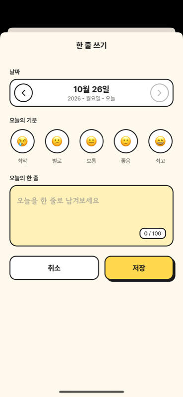 |  | 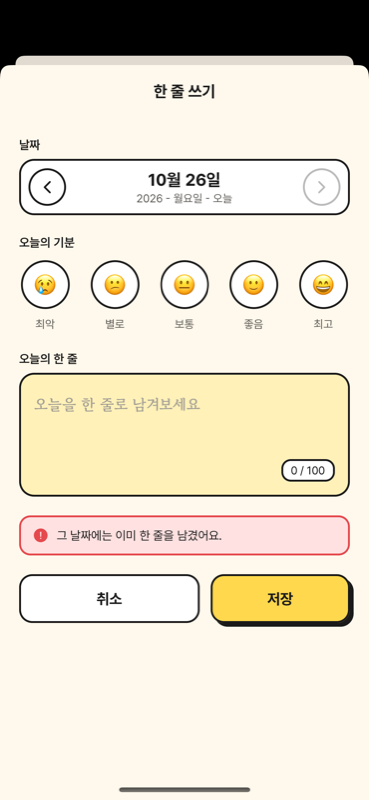 |

- 하나의 모달 화면(`ManageEntry`)이 `route.params.entryId` 유무로 쓰기와 수정을 나눕니다.
- 날짜는 ‹ › 버튼으로만 바꿉니다. 오늘에서는 › 가 비활성이라 미래 날짜를 고를 수 없습니다.
- 기분을 고르지 않았거나 내용이 비어 있으면 요청을 보내지 않고 해당 칸을 빨갛게 표시합니다.
- 같은 날짜에 이미 한 줄이 있으면 서버가 409로 거절하고, 서버 메시지를 배너로 보여 줍니다.
- 수정 화면 아래의 "이 한 줄 삭제"를 누르면 확인 Alert 후 삭제합니다.
- 저장, 수정, 삭제가 성공하면 `EntriesContext`를 갱신해서 홈 카드, 통계, 달력, 목록이 바로 바뀝니다.

### 프로필과 계정

| 프로필 수정 | 계정 | 회원 탈퇴 |
|:---:|:---:|:---:|
| 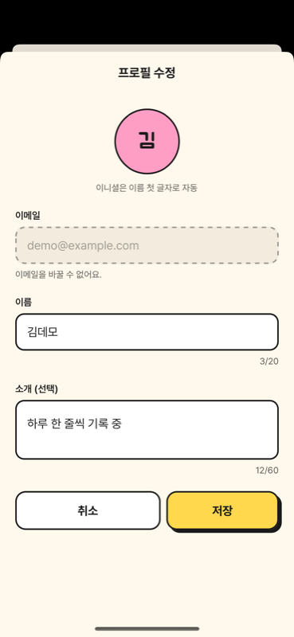 | 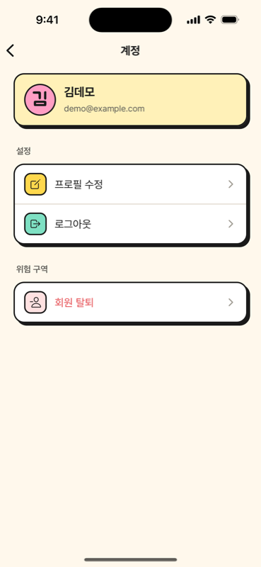 | 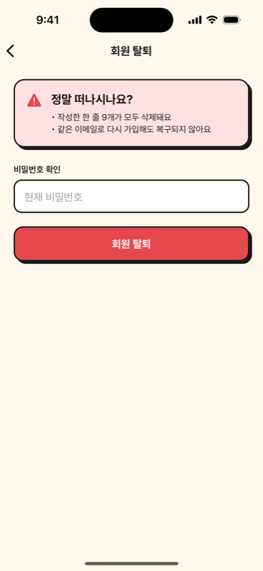 |

- **프로필 수정:** 이름과 소개를 `PATCH /users/me`로 저장합니다. 이메일은 읽기 전용입니다. 저장하면 `AuthContext`의 user가 바뀌어 홈 인사와 계정 카드에 바로 반영됩니다.
- **계정:** 설정 행은 `constants/RowItems.js`의 데이터로 그립니다. 로그아웃은 확인 Alert 후 서버에 토큰 폐기를 요청하고, 요청이 실패해도 앱에서는 로그아웃합니다.
- **회원 탈퇴:** 비밀번호를 비워 두면 입력칸에 에러를 표시합니다. 확인 Alert를 거쳐 `DELETE /users/me`를 보냅니다. 비밀번호가 틀리면 서버가 403으로 거절하고 배너를 띄우며, 다시 입력하면 배너가 사라집니다.

## 시작하기

### 준비

- Node.js 20 이상
- Python 3.10 이상
- 실행할 기기 중 하나
  - iOS 시뮬레이터 (Xcode 필요)
  - Android 에뮬레이터 (Android Studio 필요)
  - 실제 폰 + [Expo Go](https://expo.dev/go) 앱

### 1. 설치

```sh
git clone https://github.com/ios-carki/Daily_Line.git
cd Daily_Line
npm install
```

### 2. 서버 설정

처음 한 번만 가상환경을 만들고 패키지를 설치합니다.

```sh
cd server
python3 -m venv .venv
.venv/bin/pip install -r requirements.txt
```

```sh
.venv/bin/fastapi dev main.py --host 0.0.0.0 --port 8000
```

- `--host 0.0.0.0`이 있어야 실제 폰과 Android 에뮬레이터에서 접속할 수 있습니다.
- 처음 켜면 `server/app.db`가 생기고 데모 계정이 들어갑니다.
- 켜졌는지 확인: `curl http://localhost:8000/health` → `{"ok":true}`
- API 문서(Swagger): http://localhost:8000/docs
- 끄기: 서버 터미널에서 `Ctrl + C`

### 3. .env 만들기 (선택)

API 주소는 비워 두면 Expo 개발 서버 주소를 보고 자동으로 정합니다(`constants/env.js`). 자동으로 잡은 주소로 연결되지 않을 때만 `.env`를 만드세요.

```sh
cp .env.example .env
```

`.env`의 `EXPO_PUBLIC_API_URL`을 실행 기기에 맞게 바꿉니다.

| 실행 기기 | `EXPO_PUBLIC_API_URL` |
|---|---|
| iOS 시뮬레이터 | `http://localhost:8000` |
| Android 에뮬레이터 | `http://10.0.2.2:8000` |
| 실제 폰 (Expo Go) | `http://<Mac의 LAN IP>:8000` (폰과 Mac이 같은 Wi-Fi) |

`.env`를 바꾼 뒤에는 `npx expo start -c`로 캐시를 지우고 다시 실행해야 반영됩니다.

### 4. 앱 실행

```sh
npm start
```

터미널에서 `i`(iOS 시뮬레이터) 또는 `a`(Android 에뮬레이터)를 누르거나, 실제 폰의 Expo Go로 QR 코드를 찍습니다.

### 데모 계정

| 이메일 | 비밀번호 | 데이터 |
|---|---|---|
| `demo@example.com` | `demo1234` | 일기 9개 |

## API 요약

인증이 필요한 요청은 `Authorization: Bearer <token>` 헤더를 붙입니다. 에러는 항상 `{ "detail": "한국어 메시지" }` 형식이라, 앱은 `err.response.data.detail`을 그대로 보여 줍니다.

| 메서드 | 경로 | 설명 |
|---|---|---|
| POST | `/auth/signup` | 회원가입 → `{ token, user }` |
| POST | `/auth/login` | 로그인 → `{ token, user }` |
| POST | `/auth/logout` | 토큰 폐기 |
| GET | `/users/me` | 내 정보 |
| PATCH | `/users/me` | 이름, 소개 수정 |
| DELETE | `/users/me` | 회원 탈퇴 (바디에 `{ password }`) |
| GET | `/entries` | 내 일기 목록 (날짜 내림차순) |
| POST | `/entries` | 한 줄 쓰기 |
| PUT | `/entries/{id}` | 한 줄 수정 |
| DELETE | `/entries/{id}` | 한 줄 삭제 |

자세한 요청과 응답 형식, 상태 코드는 [server/README.md](server/README.md)에 있습니다.

## 폴더 구조

```
├── App.js              네비게이션 (AuthStack / AuthenticatedStack ⊃ MainTabs), 자동 로그인
├── api/                axios 인스턴스와 API 함수 (auth, user, entry)
├── store/              AuthContext, EntriesContext
├── screens/            화면 8개
├── components/
│   ├── UI/             ShadowBox, Button, Input, LoadingOverlay, ErrorBanner, TabIcon 등
│   ├── Auth/           AuthForm, PasswordMeter
│   ├── Home/           Avatar, StatsRow, MoodCalendar, NoteCard
│   ├── Entries/        EntryForm, DateStepper, MoodPicker, NoteInput, FilterChips, EntryRow, EmptySticker
│   ├── Profile/        ProfileForm
│   └── Account/        ListGroup, ListRow
├── constants/          색과 폰트 토큰, 기분 목록, 네비게이션 옵션, API 주소
├── util/               날짜, 기분, 검증, 토큰 저장
├── assets/fonts/       Jua, Pretendard, Gowun Batang
└── server/             FastAPI + SQLite 서버
```

## 네비게이션 구조

```
NavigationContainer
├ AuthStack (로그아웃 상태)
│  ├ Login
│  └ Signup
└ AuthenticatedStack (로그인 상태)
   ├ Main (Bottom Tabs)
   │  ├ Home
   │  └ Entries
   ├ ManageEntry   (modal)
   ├ EditProfile   (modal)
   ├ Account
   └ Withdraw
```

`AuthContext`의 토큰 유무로 두 Stack 중 하나를 그립니다. 로그인하거나 로그아웃할 때 `navigate`를 부르지 않아도 화면이 자동으로 바뀝니다. 탭 위에 쌓이는 화면(Account, Withdraw, 모달)에는 탭바가 보이지 않습니다.
